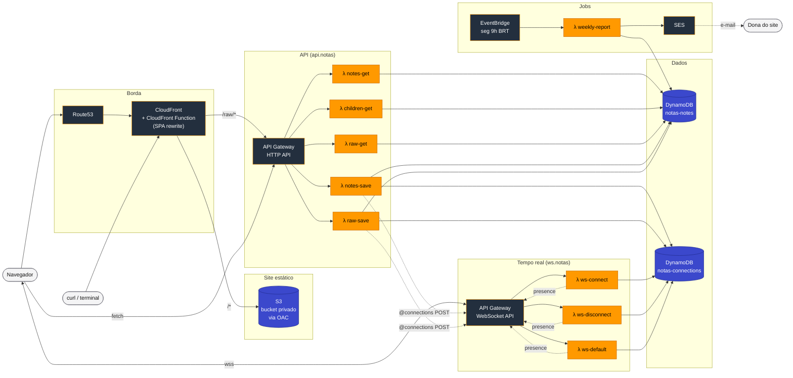
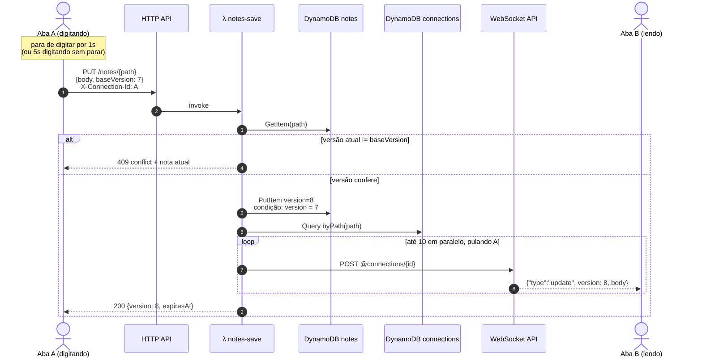
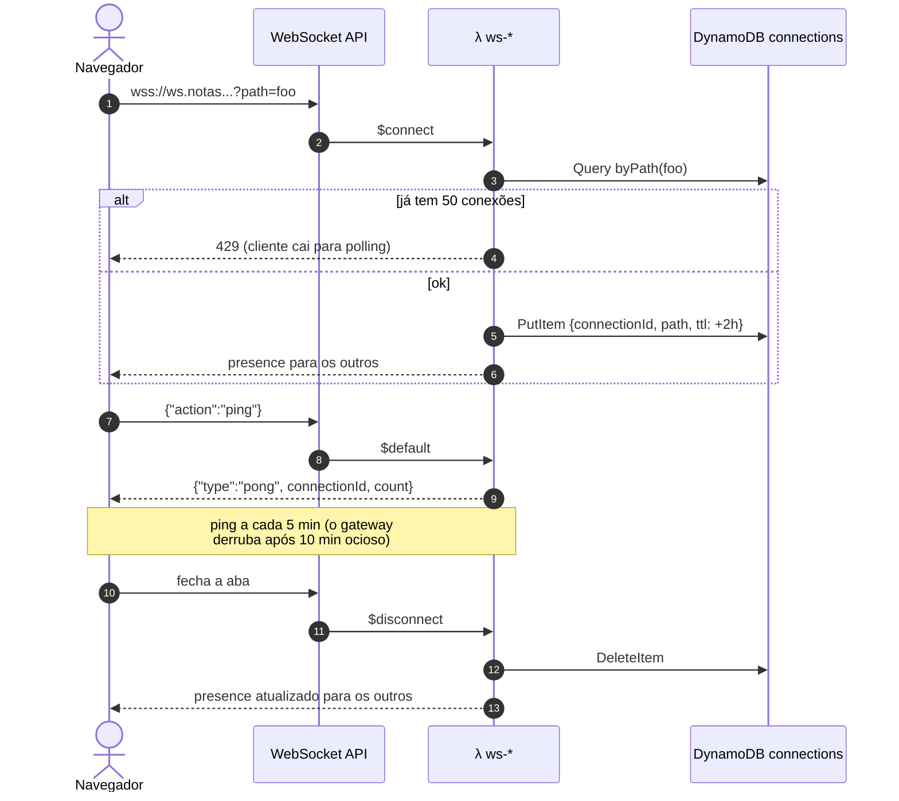
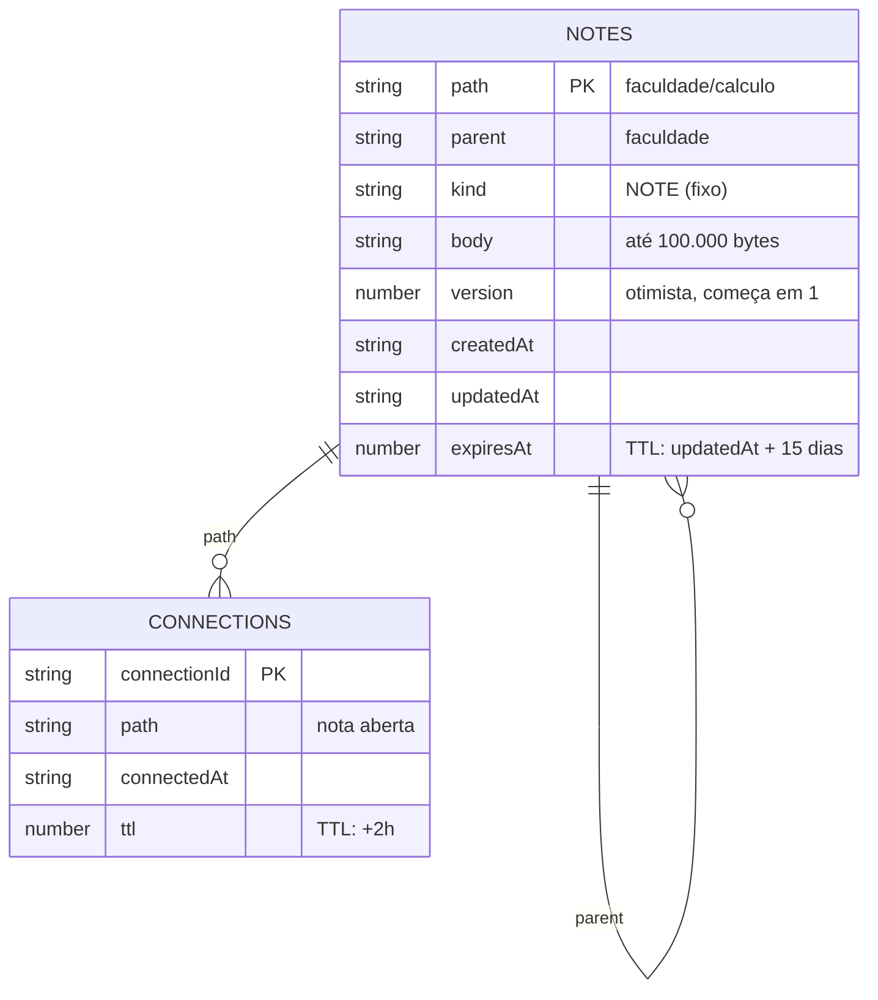
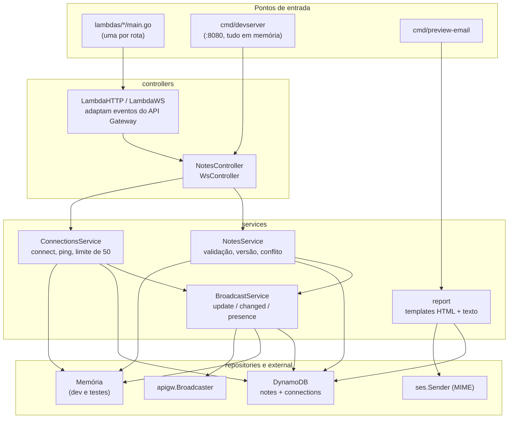
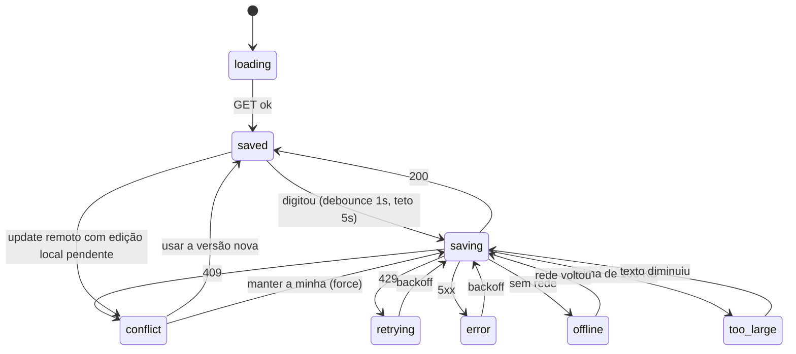
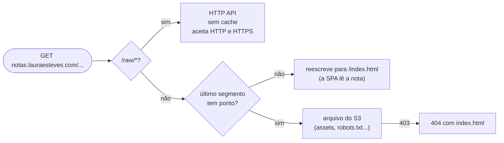
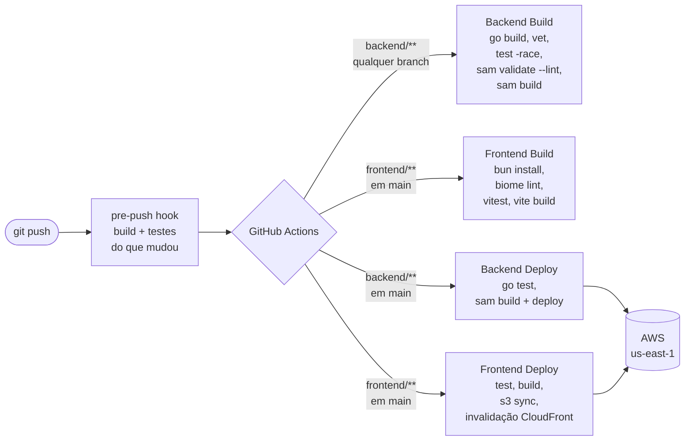

# notas.lauraesteves.com

Bloco de notas colaborativo sem login, inspirado no [dontpad](https://dontpad.com). A URL é a nota: `notas.lauraesteves.com/qualquer-coisa`.

- Salva sozinho quando você para de digitar.
- Quem estiver com a mesma URL aberta vê as mudanças em tempo real.
- Subpáginas: `notas.lauraesteves.com/faculdade/calculo`.
- Pelo terminal: `curl notas.lauraesteves.com/raw/qualquer-coisa`, ou instale os comandos `nota` e `nota-add` com `curl -fsSL https://notas.lauraesteves.com/install.sh | sh` (bash ou zsh).
- As notas somem 15 dias depois da última edição.
- Toda nota é pública para quem souber a URL. Não guarde senhas aqui.

## Sumário

- [Stack](#stack)
- [Arquitetura](#arquitetura)
  - [Visão geral](#visão-geral)
  - [Por que serverless](#por-que-serverless)
  - [Salvar e propagar uma edição](#salvar-e-propagar-uma-edição)
  - [Ciclo de vida do WebSocket](#ciclo-de-vida-do-websocket)
  - [Modelo de dados](#modelo-de-dados)
  - [Camadas do backend](#camadas-do-backend)
  - [Sincronização no navegador](#sincronização-no-navegador)
  - [Roteamento no CloudFront](#roteamento-no-cloudfront)
  - [Relatório semanal](#relatório-semanal)
  - [Segurança e limites](#segurança-e-limites)
- [Estrutura](#estrutura)
- [Desenvolvimento](#desenvolvimento)
- [CI/CD](#cicd)
- [Deploy](#deploy)
- [Contrato](#contrato)

## Stack

| Parte | Tecnologia |
|-|-|
| Frontend | React 19, Vite, Tailwind v4, TypeScript, bun, Biome, Vitest |
| Backend | Go, AWS Lambda (arm64, `provided.al2023`), SAM |
| Dados | DynamoDB on-demand, TTL nativo para expiração |
| Tempo real | API Gateway WebSocket API |
| E-mail | SES v2 (relatório semanal), agendado pelo EventBridge |
| Hospedagem | S3 + CloudFront (OAC, HTTP/3), DNS no Route53, certificado ACM |
| CI/CD | GitHub Actions |

## Arquitetura

### Visão geral

Tudo roda em serviços gerenciados da AWS, em `us-east-1`. Não existe servidor ligado esperando requisição: o site é estático no CloudFront, cada rota da API é uma Lambda pequena em Go e o estado fica todo no DynamoDB.



Três domínios, um certificado ACM para `notas.lauraesteves.com` e `*.notas.lauraesteves.com`:

| Domínio | Aponta para | Uso |
|-|-|-|
| `notas.lauraesteves.com` | CloudFront | SPA e `/raw/*` para o terminal |
| `api.notas.lauraesteves.com` | HTTP API (regional) | Leitura e escrita de notas |
| `ws.notas.lauraesteves.com` | WebSocket API (regional) | Atualizações em tempo real e presença |

### Por que serverless

O tráfego de um bloco de notas pessoal é baixo e em rajadas: horas parado, depois alguém digitando por dez minutos. Pagar por requisição encaixa melhor do que manter uma instância ligada.

- **Custo perto de zero em repouso.** Lambda, API Gateway e DynamoDB on-demand cobram por uso. CloudFront e S3 custam centavos para um SPA pequeno.
- **Nenhum servidor para manter.** Sem patch de sistema operacional, sem autoscaling para configurar, sem processo para reiniciar.
- **Uma Lambda por rota.** Cada função tem só a permissão IAM de que precisa (a de leitura não consegue escrever) e um binário pequeno.
- **Go em arm64 com runtime `provided.al2023`.** Binário nativo, cold start curto, 128 MB de memória bastam. Graviton é mais barato que x86.
- **Expiração de graça.** O TTL nativo do DynamoDB apaga notas e conexões vencidas sem job de limpeza. Como o TTL pode atrasar, toda leitura também confere `expiresAt` e trata nota vencida como inexistente.
- **WebSocket gerenciado.** O API Gateway segura as conexões abertas; as Lambdas só rodam quando alguém conecta, desconecta, manda `ping` ou quando uma nota muda.

Os trade-offs aceitos: o API Gateway derruba conexões depois de 2h (o cliente reconecta), o índice `byPath` é eventualmente consistente (a presença se corrige no próximo `ping`) e mensagens de WebSocket têm limite de tamanho (notas grandes mandam só um aviso `changed`).

### Salvar e propagar uma edição

O cliente salva com versionamento otimista: manda a versão em que a edição se baseou e o DynamoDB só aceita a escrita se ela ainda for a atual (escrita condicional). Depois de salvar, a mesma Lambda avisa as outras abas abertas na nota.



- Corpo até 28.000 bytes vai inteiro na mensagem `update`. Acima disso vai `changed` e quem recebe faz `GET`.
- Corpo vazio apaga a nota e propaga `update` com `version: 0`.
- Conexão que responde `410 Gone` é apagada da tabela na hora.
- `PUT /raw/{path}` (pelo terminal) é o mesmo fluxo com `force: true` (last-write-wins).

### Ciclo de vida do WebSocket



Se o WebSocket não conectar, o cliente faz polling com `GET /notes/{path}?since={version}` a cada 5s, só com a aba visível. Ao reconectar (backoff de 1s até 30s) ele busca a nota de novo para não perder nada.

### Modelo de dados

Duas tabelas DynamoDB on-demand, ambas com TTL.



| Tabela | Índice | Chave | Para quê |
|-|-|-|-|
| `notas-notes` | tabela | `path` | Ler e salvar uma nota |
| `notas-notes` | GSI `byParent` | `parent` + `path` | Listar subpáginas (`/children`) |
| `notas-notes` | GSI `byUpdated` | `kind` + `updatedAt` | Notas mais recentes (relatório semanal) |
| `notas-connections` | tabela | `connectionId` | Conectar e desconectar |
| `notas-connections` | GSI `byPath` | `path` | Quem está na nota (broadcast e presença) |

Os GSIs projetam só os atributos necessários (`INCLUDE`) para manter as leituras baratas.

### Camadas do backend

O mesmo código de negócio serve as Lambdas e o servidor local. Só muda a ponta: em produção os adaptadores são DynamoDB e o `@connections` do API Gateway; em desenvolvimento são memória e um hub de WebSocket em Go.



`helpers` concentra a regra de caminho (segmentos `[a-z0-9_-]`, até 5 níveis, nomes reservados), que o frontend replica em `src/lib/path.ts`.

### Sincronização no navegador

`src/lib/noteSync.ts` é um motor de sincronização sem React, testado com Vitest. `useNote` só o liga ao componente. O status mostrado na barra de baixo segue esta máquina:



Quando chega uma nota do servidor (WebSocket, polling ou o corpo de um `409`), o cliente decide entre ignorar (eco próprio ou versão velha), adotar (o remoto já é igual ao texto local), aplicar (não há edição local pendente) ou abrir o banner de conflito. Ao aplicar texto remoto, a posição do cursor é preservada (`src/lib/cursor.ts`). Saves com falha tentam de novo com backoff exponencial até 30s.

### Roteamento no CloudFront



Como caminho de nota nunca tem ponto, a CloudFront Function separa nota de arquivo estático sem consultar nada. `/raw/*` aceita HTTP puro para `curl notas.lauraesteves.com/raw/x` funcionar sem `-L`.

### Relatório semanal

Toda segunda às 9h (BRT), o EventBridge dispara `notas-weekly-report`. Ela consulta o GSI `byUpdated` pelas notas editadas nos últimos 7 dias, monta um e-mail em HTML (tema escuro, que se mantém no Gmail) e em texto puro, e envia pelo SES como "Cortex". `make backend-preview-email` gera o e-mail localmente para conferir o layout.

### Segurança e limites

| Camada | Proteção |
|-|-|
| CloudFront | HSTS, CSP restrita (`connect-src` só para `api.notas` e `ws.notas`), `X-Frame-Options: DENY`, `Permissions-Policy`, TLS 1.2+ |
| S3 | Bucket privado, acesso só pelo CloudFront via OAC, criptografia AES-256 |
| API Gateway | Throttling de 20 req/s (rajada de 40) no HTTP e no WebSocket, CORS só para o domínio e `localhost:5173` |
| Lambda | IAM mínimo por função (leitura não escreve; só quem salva ou gerencia conexões pode postar em `@connections`) |
| Domínio | Corpo até 100 KB, caminho validado no backend, 50 conexões por nota, notas expiram em 15 dias |

Não há autenticação, por design: a URL é o segredo. Daí o aviso de não guardar senhas.

## Estrutura

```
frontend/       app React (S3 + CloudFront)
  src/lib/        lógica pura: api, noteSync, saveScheduler, socket, path, cursor
  src/hooks/      useNote, useNoteSocket, usePageMeta
backend/        Lambdas em Go, template SAM e servidor local
  lambdas/        um main.go por função (api/*, ws/*, workers/*)
  internal/       controllers, services, repositories, external, models, helpers
  cmd/            devserver e preview-email
infra/          CloudFormation do frontend (bucket, CloudFront, DNS)
docs/           contrato da API (docs/api.md)
scripts/        git hooks
```

## Desenvolvimento

```bash
make init              # instala o pre-push hook
make backend-dev       # API + WebSocket em memória em :8080
make frontend-server   # Vite em :5173, apontando para :8080
```

Testes: `make backend-test` e `make frontend-test`.

Prévia do e-mail semanal: `make backend-preview-email`.

O `devserver` implementa o contrato inteiro (HTTP e WebSocket) com os mesmos services das Lambdas, então não precisa de AWS nem de Docker para desenvolver.

## CI/CD



## Deploy

1. Certificado ACM em us-east-1 para `notas.lauraesteves.com` e `*.notas.lauraesteves.com`, validado por DNS no Route53.
2. `make backend-deploy` (APIs, Lambdas, DynamoDB, domínios `api.notas` e `ws.notas`).
3. `make infra-frontend` (bucket, CloudFront, registro `notas`).
4. `make frontend-deploy`.

Depois do primeiro deploy, os workflows em `.github/workflows/` fazem o deploy de cada parte no push para `main`.

## Contrato

O formato das chamadas HTTP e das mensagens do WebSocket está em [docs/api.md](docs/api.md).
